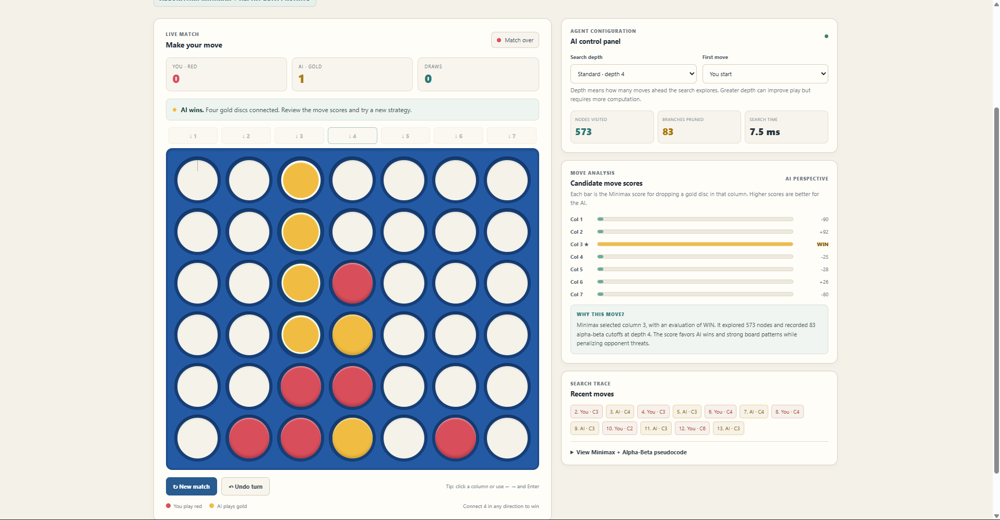
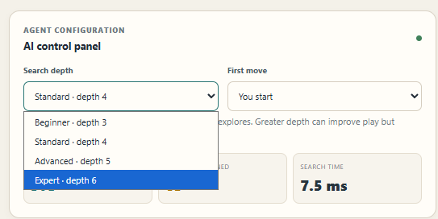
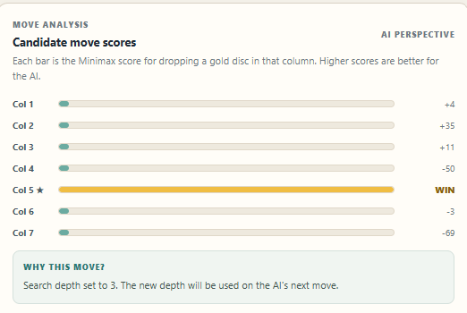

# Connect Four - Minimax with Alpha-Beta Pruning

This is my Artificial Intelligence and Soft Computing (AISC) project. It is a browser-based Connect Four game where a person plays against a computer opponent. The computer uses the **Minimax algorithm with Alpha-Beta Pruning** to choose its moves.

I chose Connect Four because the rules are easy to understand, but a good move depends on what the other player might do next. That makes it a useful game for showing adversarial search.

The project uses HTML, CSS and JavaScript. To run it, you only need a web browser; there is no server or package installation required.

## Student details

- **Name:** Siddhesh Singh Parmar
- **Registration number:** 2427030221
- **Section:** E
- **Programme:** B.Tech CSE Core
- **Subject:** Artificial Intelligence and Soft Computing (AISC)

## Project objectives

I wanted to build a game where I could demonstrate how an AI makes decisions when another player is actively trying to stop it. The main objectives are:

- Build a playable Connect Four game for one person against the computer.
- Use Minimax to compare possible moves for both players.
- Add Alpha-Beta Pruning to avoid searching branches that cannot affect the decision.
- Use a heuristic evaluation to compare positions when the search reaches its depth limit.
- Show search information on the page so the AI's decision can be discussed during a demonstration.

## Connect Four as a search problem

I modelled the game as a two-player, turn-based search problem:

| Part | Meaning in this project |
|---|---|
| State | The current arrangement of the 6 by 7 board |
| Initial state | An empty board at the start of a match |
| Players | Human (Red) and computer (Gold) |
| Actions | Drop a disc into any column that is not full |
| Transition | The disc falls into the lowest empty cell in the selected column |
| Goal | Connect four discs horizontally, vertically or diagonally |
| Terminal states | A win for either player, or a full board with no winner |

The game is deterministic and has perfect information: a move has a predictable result, and both players can see the whole board. Since one player's win is the other player's loss, it is suitable for adversarial search.

## Screenshots

### Game board and search information

This screenshot shows a match in which the AI has won. The right side of the page displays the search depth, number of nodes visited, alpha-beta cutoffs, candidate move scores and recent moves.



### Search depth options

The game has four search-depth settings. A higher depth lets the AI look further ahead, but it usually takes more time to search.



### Candidate move scores

The chart shows the score calculated for each legal column from the AI's point of view. These are evaluation scores, not percentages or probabilities of winning.



## What the game does

The board has 6 rows and 7 columns. The human player uses red discs and the computer uses gold discs. Players take turns dropping a disc into a column. The disc occupies the lowest empty position in that column. The first player to connect four discs horizontally, vertically or diagonally wins. If the board fills up without a winner, the match is a draw.

In addition to the game itself, the page shows some information about the computer's search. This is useful when demonstrating the algorithm because you can see the scores it gave to possible moves and how much of the search tree it examined.

## How the AI chooses a move

The AI uses three parts together:

1. **Minimax** searches possible moves for both players.
2. **Alpha-Beta Pruning** avoids exploring parts of the search tree that cannot change the decision.
3. **Heuristic evaluation** gives a score to a board position when the search reaches its depth limit.

The computer is the **MAX** player. It tries to get the highest score. The human is treated as the **MIN** player, because the search assumes the human will choose moves that make the AI's score as low as possible. The players alternate between MAX and MIN levels in the search tree.

### Minimax and Alpha-Beta Pruning

At each turn, the AI considers the legal columns. It simulates placing a gold disc in a column and then searches the possible replies. On the human's simulated turn, it assumes the human will choose the response with the lowest score for the AI. The AI then chooses the root move with the highest returned score.

Alpha and beta keep track of the best values found so far:

- **Alpha (α)** is the best value MAX can guarantee so far.
- **Beta (β)** is the best value MIN can guarantee so far.
- When **α ≥ β**, the remaining children of that node are not searched. This is called a cutoff or pruning.

The pruning does not change the Minimax result for the same search depth and evaluation function. It reduces the number of positions that need to be examined.

The pseudocode used by the project follows this structure:

```text
MINIMAX(state, depth, alpha, beta, maximizing):
    if state is a win, loss or draw:
        return terminal score

    if depth == 0:
        return heuristic evaluation

    if maximizing:                  // AI's turn
        value = -infinity
        for each legal move:
            child = make the AI move
            value = max(value, MINIMAX(child, depth - 1,
                                       alpha, beta, false))
            alpha = max(alpha, value)
            if alpha >= beta:
                stop searching this branch
        return value

    else:                           // Human's turn
        value = +infinity
        for each legal move:
            child = make the human move
            value = min(value, MINIMAX(child, depth - 1,
                                       alpha, beta, true))
            beta = min(beta, value)
            if beta <= alpha:
                stop searching this branch
        return value
```

### Heuristic evaluation

The AI cannot search all the way to the end of every possible game, so it uses a heuristic when it reaches the selected depth. The score is always from the AI's point of view: positive values are good for the AI and negative values are good for the human.

The evaluator looks at the centre column and groups of four connected cells. It checks horizontal, vertical and both diagonal directions. The current scoring weights are:

| Pattern | Score added to the AI's evaluation |
|---|---:|
| Each AI disc in the centre column | +7 |
| Each human disc in the centre column | -7 |
| 1 AI disc and 3 empty cells in a group of four | +2 |
| 2 AI discs and 2 empty cells | +14 |
| 3 AI discs and 1 empty cell | +90 |
| 1 human disc and 3 empty cells | -2 |
| 2 human discs and 2 empty cells | -16 |
| 3 human discs and 1 empty cell | -110 |

A group containing discs from both players receives no pattern score. The stronger penalty for a human three-in-a-row makes the AI take an opponent's threat seriously. These numbers are hand-chosen weights; they are not win probabilities.

Wins, losses and draws are checked separately before the heuristic is used. The terminal scores in the implementation are:

- AI win: `10,000,000 + remaining depth`
- Human win: `-10,000,000 - remaining depth`
- Draw: `0`

The large values make an actual win or loss more important than an ordinary heuristic score. The depth adjustment gives the AI a reason to prefer winning sooner and, when it cannot avoid losing, to delay the loss.

### Search depth and move order

The user can select one of four depths:

| Setting | Search depth |
|---|---:|
| Beginner | 3 plies |
| Standard | 4 plies |
| Advanced | 5 plies |
| Expert | 6 plies |

A **ply** means one player's move. The selected depth is used for the next AI search. Increasing the depth lets the AI consider more replies, but it also increases the amount of work it may have to do.

The AI checks the centre columns first, in this order: `4, 3, 5, 2, 6, 1, 7` (columns as numbered on the board). The centre is a useful place to play because it is part of more possible four-in-a-row lines. Checking promising columns early can also help Alpha-Beta Pruning find cutoffs sooner.

## Understanding the move-analysis panel

After the AI searches, the panel displays:

- **Candidate move scores:** the Minimax score for each legal column, from the AI's point of view. A higher score is better for the AI. `WIN` or `LOSS` is shown for terminal outcomes.
- **Nodes visited:** the number of recursive Minimax calls made during the search of all root candidates.
- **Branches pruned:** this counter records how many alpha-beta cutoff events occurred. It is not the exact number of individual nodes skipped.
- **Search time:** the time taken for the candidate move search, shown in milliseconds. It can vary with the board position, selected depth and computer.
- **Search depth:** the number of plies selected for the next AI move.

The score bars compare the absolute size of the scores. They are only a visual guide; they are not probabilities. When a winning move has a very large score, the other bars can look much smaller as a result.

## Technologies used

- **HTML** for the page structure.
- **CSS** for the layout, board and styling.
- **JavaScript** for the game rules, Minimax search, pruning, evaluation and dashboard.

The project does not use a framework or external JavaScript library.

## How to run it

1. Download or clone this repository.
2. If you downloaded a ZIP file, extract it.
3. Open the project folder.
4. Double-click `index.html` to open the game in a browser.

No Python, Node.js, npm or separate server is needed.

To clone the repository, open its GitHub page, click **Code**, copy the HTTPS URL, and run `git clone` followed by that URL in a terminal. Then open the downloaded project folder and double-click `index.html`.

## How to play

- You play as **Red** and the computer plays as **Gold**.
- Click a column or one of its cells to drop your disc.
- You can also use the left and right arrow keys to choose a column, then press Enter.
- Use **New match** to start again.
- Use **Undo turn** to take back the last human move and the AI reply.
- Choose a search depth from the AI control panel. The new setting is used on the next AI move.
- Use the **First move** setting to decide whether you or the AI starts the next match.

## Complexity

Let `b` be the branching factor (the number of legal moves from a position) and `d` be the search depth.

- Minimax has a time complexity of `O(b^d)`.
- Alpha-Beta Pruning has a best-case time complexity of about `O(b^(d/2))` when move ordering is very good.
- Its worst case is still `O(b^d)`, when the move order does not help pruning.

The board is small and fixed at 6 by 7, but the number of possible move sequences grows quickly as the search depth increases. The implementation uses recursive depth-first search and makes a board copy for each simulated move. The active search path therefore uses memory related to the depth of the search and the board size.

## Things to check before a demonstration

These are useful manual checks to try before showing the project:

1. Make a move and check that the disc falls to the lowest empty cell in that column.
2. Fill a column and confirm that another disc cannot be placed in it.
3. Try to make four discs in a row horizontally, vertically and diagonally.
4. Set up a position where the AI can win immediately and see whether it takes the winning move.
5. Set up a position where the human is about to win and see whether the AI tries to block it.
6. Change the search depth and compare the nodes visited and search time on similar board positions.
7. Try Undo turn, New match and the option that lets the AI start. In particular, let the AI make the opening move, press Undo turn, and confirm that the AI takes its turn again instead of leaving the game stuck.

These are manual demonstration checks. The repository does not include a separate automated test suite.

## Limitations and possible improvements

The AI searches only to the selected depth, so it does not guarantee perfect play. Its choices also depend on the heuristic weights. The current heuristic counts patterns of four cells, but it does not fully check whether the empty cell in every pattern can be played immediately under Connect Four's gravity rule. Search time can also increase as the depth goes up.

Some possible improvements would be to add a more detailed check for playable threats, use iterative deepening with a time limit, store previously evaluated board positions, and add automated tests for the game rules and search decisions.

## References

- Stuart Russell and Peter Norvig, *Artificial Intelligence: A Modern Approach*, 4th edition. See the sections on game playing and adversarial search.
- AISC lecture notes covering game trees, Minimax, heuristic evaluation and Alpha-Beta Pruning.

---

**Siddhesh Singh Parmar**  
B.Tech CSE Core, Section E  
Registration No.: 2427030221  
Artificial Intelligence and Soft Computing (AISC)
